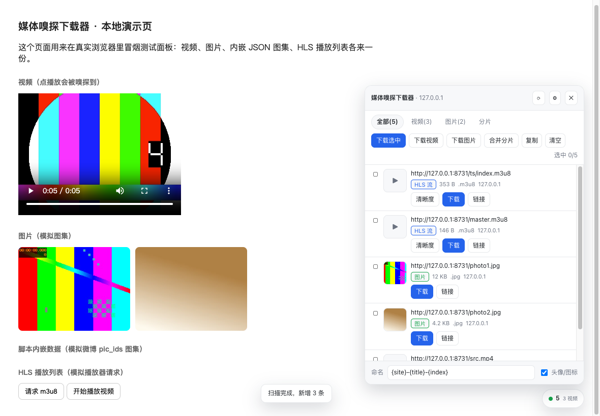
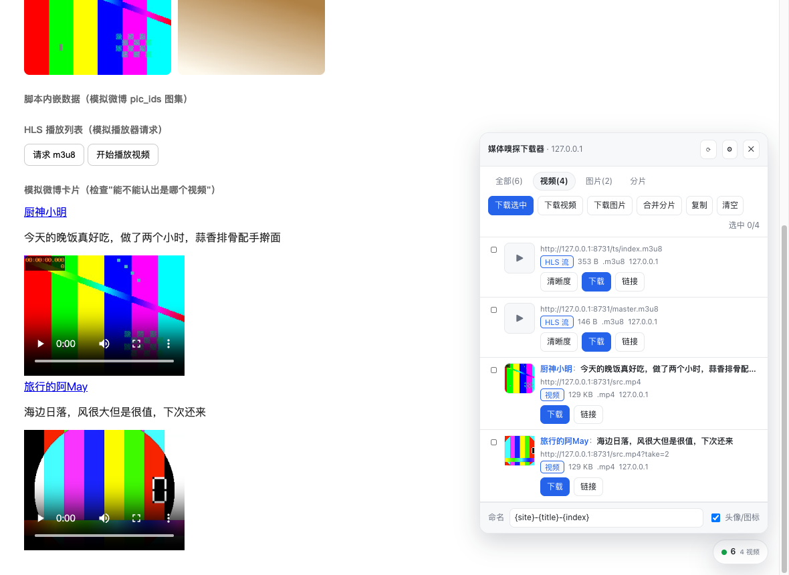

# 媒体嗅探下载器（Tampermonkey）

在微博、知乎、小红书这类站点上，把**网页里真实播放/显示的视频和图片**抓出来下载。
不依赖站点的页面结构（那些天天变），而是关注两件事：

1. **嗅探播放器真正请求的地址**——带时效签名的直链、m3u8、分片，页面自己知道，我们跟着抄；
2. **站点规则**——防盗链 Referer、缩略图还原原图、头像图标过滤、HLS 分片解密。

## 安装

仓库地址：<https://github.com/jackbi/tampermonkey-plugin-media-saver>

**一键安装**：装好 Tampermonkey 后，直接打开
<https://raw.githubusercontent.com/jackbi/tampermonkey-plugin-media-saver/main/dist/media-saver.user.js>
会弹出安装页。国内网络访问 `raw.githubusercontent.com` 不通时，用下面任一方式。

**手动安装**：

1. 浏览器装 [Tampermonkey](https://www.tampermonkey.net/) 扩展；
2. 打开 `dist/media-saver.user.js`，全选复制；
3. Tampermonkey 面板 → 「添加新脚本」→ 粘贴覆盖 → `Ctrl/Cmd + S` 保存。

想在 GreasyFork 上架：表单字段、详细描述与同步设置都整理在 [greasyfork/listing.md](greasyfork/listing.md)。

首次在某些域名上下载时，Tampermonkey 会弹出「是否允许访问 xxx.com」，选**允许**（跨域拿媒体必须走这一步）。

默认只在 **微博 / 知乎 / 小红书** 三个站点注入，其它网站完全不加载：

```
@match  *://*.weibo.com/*
@match  *://*.weibo.cn/*
@match  *://*.zhihu.com/*
@match  *://*.xiaohongshu.com/*
```

脚本要在 `document-start` 挂钩页面的 fetch / XHR 才能拿到带签名的真实地址，装到每个网站上就是给每个页面
挂一个请求嗅探器，既没必要也不合适，所以只按站点清单启用。想加站点见文末「扩展到新站点」。

## 用法

打开微博 / 知乎 / 小红书任意页面，右下角会出现一个悬浮球（带数量），点开就是面板；也可以按 `Alt + S`，
或从 Tampermonkey 菜单里打开。



| 操作 | 说明 |
| --- | --- |
| 点整行 | 勾选 / 取消勾选 |
| 下载选中 | 下载已勾选的条目 |
| 下载视频 / 下载图片 | 一键下载当前列出的全部视频或图片（图集必备） |
| 合并分片 | 站点没暴露 m3u8、只暴露了 ts/m4s 分片时，按顺序拼成一个文件 |
| 清晰度 | HLS 流会列出可选清晰度，默认自动选最高 |
| 用原图 / 用缩略图 | 图片默认还原成原图下载，可切回页面里那张小图 |
| 命名 | 文件名模板，支持 `{site} {title} {index} {host} {ext}` |

### 怎么认出「这个视频是哪个」

微博一条时间线里能有好几个视频，地址是 `f.video.weibocdn.com/o0/xxxx.mp4` 这种看不出内容的串。所以每个视频都会被标上三样东西：



- **标题行**：从视频所在的卡片（或页面内嵌数据）里抠出「作者 + 正文片段」，例如「厨神小明 今天的晚饭真好吃…」；
- **缩略图**：优先用视频封面。没有封面的话，**鼠标在那一行停一下**，浏览器会直接取第一帧显示出来（不用下载整段视频）；
- **页面顺序**：列表按媒体在页面里出现的顺序排列，和你在页面上从上往下看到的顺序一致。

同一个视频的多档清晰度会合并成一条并在「清晰度」下拉里选择；判断不出是同一视频时**不会**合并，避免把两个不同视频错并成一个。

**重要**：嗅探是基于"页面实际发出的请求"，所以视频**先播放一次**（或让图集滚动加载出来），
再点面板标题栏的 `⟳` 重新扫描，命中率最高。页面内嵌 JSON 里的资源不需要播放，`⟳` 一次就能扫到。

## 各站点情况

| 站点 | 视频 | 图片 |
| --- | --- | --- |
| 微博 | 播放后拿到 `weibocdn` 直链，同一视频的多档清晰度会合并成一条，默认最高档 | `/orj360/`、`/bmiddle/` 等缩略图自动还原为 `/large/`；只有 `pic_ids` 的图集也能扫出来 |
| 知乎 | 播放器走 m3u8，AES-128 加密的分片会在浏览器里解密后合并 | 去掉 `/80/` 尺寸目录与 `_1440w` 后缀，还原原图 |
| 小红书 | `sns-video` 直链 mp4；HLS 流走 fMP4，产物直接是 `.mp4` | 去掉 `!nd_dft…` 处理后缀与 `imageView2` 参数，拿到原图 |
| 其它站点 | 默认不加载，需要时按「扩展到新站点」加两行配置 | — |

## 两个使用细节

**大文件（直写磁盘）**：开启后下载视频会让你选一个保存位置或文件夹，然后按 8 MB 分块边下边写，
内存占用与文件大小无关。关掉它则整段读进内存再保存，小文件更省事，几百 MB 的视频会比较吃内存。
如果弹出的保存对话框被取消，会自动回退到内存模式。

**`.ts` 需要转一道**：HLS 有两种容器，fMP4 的直接存成 `.mp4`；TS 的只能存成 `.ts`（流本身是什么就是什么）。
本机装了 ffmpeg 的话，从 Tampermonkey 菜单点「复制 TS→MP4 命令」，粘贴到终端执行即可**无损**转成 MP4
（`-c copy` 只换容器，不重新编码，几秒完成）：

```bash
ffmpeg -i ~/Downloads/"xxx.ts" -c copy ~/Downloads/"xxx.mp4"
```

## 已知限制

- **DRM / SAMPLE-AES 的加密流下载不了**。会明确报错，而不是产出一个不能播的半成品。
- **小红书、微博部分视频自带水印**，那是服务端烧进画面的，前端换不了。
- 批量下载多个文件时 Chrome 会问「此网站想下载多个文件」，需要点允许。
- 直播流的 m3u8 只能抓到当下已生成的片段，不是完整回放。
- 站点改版后，**嗅探照常可用**（它不依赖选择器）；可能失效的是「原图还原」这类页面规则，
  到时候改 `src/60-sites.js` 里对应站点的一条正则即可。

> 请只用于个人学习、收藏自己有权保存的内容，遵守各站点的服务条款与著作权规定。

## 项目结构

```
package.json          常用命令入口（build / test / demo / bump）
build.mjs             把 src/*.js 拼成单个 dist/media-saver.user.js
scripts/bump-version.mjs  同步三处版本号并重新构建
src/00-header.js      UserScript 元数据（@match / @grant / @connect）
src/10-core.js        配置持久化、事件总线、通用工具
src/20-net.js         GM 请求封装 + 嗅探引擎（资源时间线 / XHR / fetch / MSE 检测）
src/30-classify.js    媒体类型判定、体积探测、分片分组
src/40-download.js    磁盘直写、Range 分块、批量下载、命名
src/50-hls.js         m3u8 解析、AES-128 解密、分片合并
src/60-sites.js       站点规则与页面内嵌数据扫描
src/70-ui.js          悬浮面板
src/80-boot.js        启动、菜单、SPA 监听、跨框架汇总
test/                 端到端自检、测试素材生成、本地演示页
```

无任何第三方依赖（`package.json` 里没有 `dependencies`），只用 Node 18+ 自带能力：

```bash
npm run build     # 生成 dist/media-saver.user.js
npm test          # 116 项端到端自检（首次会自动生成测试素材）
npm run demo      # 起本地演示页 http://127.0.0.1:8731/demo.html
npm run bump 0.2.1  # 三处版本号一起改，并重新构建
```

## 测试

自检覆盖真实 HLS 素材：TS+AES-128 加密流、fMP4 流、Range 分块下载，产物用 ffprobe 校验时长与轨道，
并比对 Node 与浏览器两条链路的 SHA-256 是否逐字节一致。

```bash
npm test            # 会自动调用 npm run fixtures 生成素材（需要 ffmpeg）
npm run fixtures    # 只生成素材到 /tmp/ms-fix（已存在则跳过）
```

测试需要 ffmpeg 与 ffprobe（macOS：`brew install ffmpeg`）。素材与产物都在 `/tmp` 下，可随时删除，
下次 `npm test` 会重新生成。

浏览器冒烟测试（可选）：

```bash
npm run demo        # 起演示页 http://127.0.0.1:8731/demo.html
```

## 调试

页面控制台里可以直接操作脚本内部状态（前缀 `__MEDIA_SAVER__`）：

```js
__MEDIA_SAVER__.sniffer.list()          // 当前嗅探到的全部资源
__MEDIA_SAVER__.sniffer.clear()         // 清空
__MEDIA_SAVER__.ui.rescan()             // 重新扫描页面
__MEDIA_SAVER__.media.probe(items[0])   // 探测某个资源的类型与体积
```

设置里打开「调试日志」后，控制台会输出嗅探过程；菜单里的「导出调试信息」会把完整列表复制到剪贴板。

## 扩展到新站点

以 B 站为例（`src/60-sites.js` 里其实已经写好了规则，只差一个 `@match`）：

1. **放行页面**：`src/00-header.js` 里加一行 `// @match  *://*.bilibili.com/*`；
2. **放行 CDN**：如果媒体在别的域名上，再加 `// @connect  xxx.com`（不加也能下，Tampermonkey 会弹一次授权框）；
3. **加站点规则**（可选）：在 `src/60-sites.js` 的 `MS.SITES` 里加一条，写清楚防盗链用的 `referer`、
   哪些是内容图床、缩略图怎么还原原图。不写也能用，只是按通用规则处理，拿不到"原图还原"这类站点特化能力；
4. `node build.mjs` 重新打包，再按安装步骤覆盖一次脚本。

确实想让它在**所有网站**都生效（比如临时抓别的站），在 `00-header.js` 的元数据块里补一行
`*://*/*` 的匹配规则即可——但要清楚：那等于在每个页面都挂上请求嗅探钩子，这正是默认不做的事。

> 注意：`==UserScript==` 块里的匹配规则不是"注释掉就不生效"的——`// @match xxx` 这种行会被
> 脚本管理器无条件解析。要去掉一条规则，只能整行删掉，别留着。

## 版本与许可证

- 版本号以 `dist/media-saver.user.js` 头部的 `@version` 为准，改动记录见 [CHANGELOG.md](CHANGELOG.md)；
- 许可证：[MIT](LICENSE)，版权归 wayne 所有。
